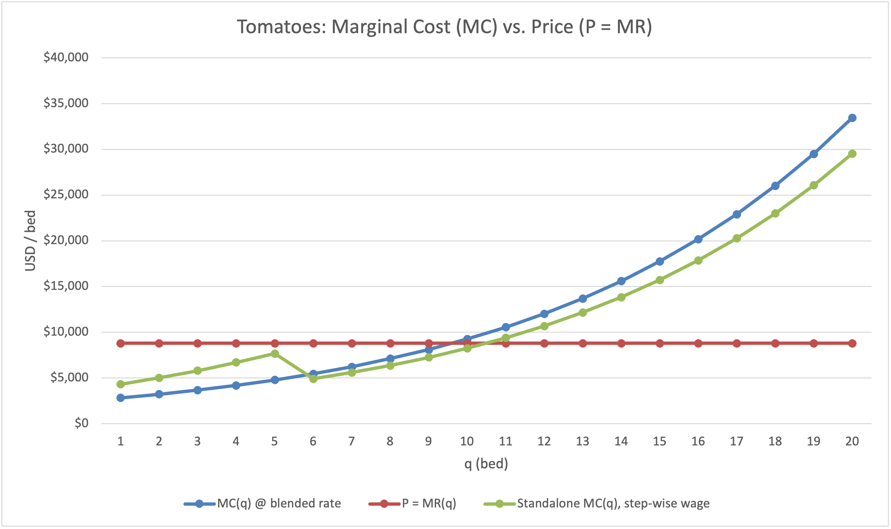
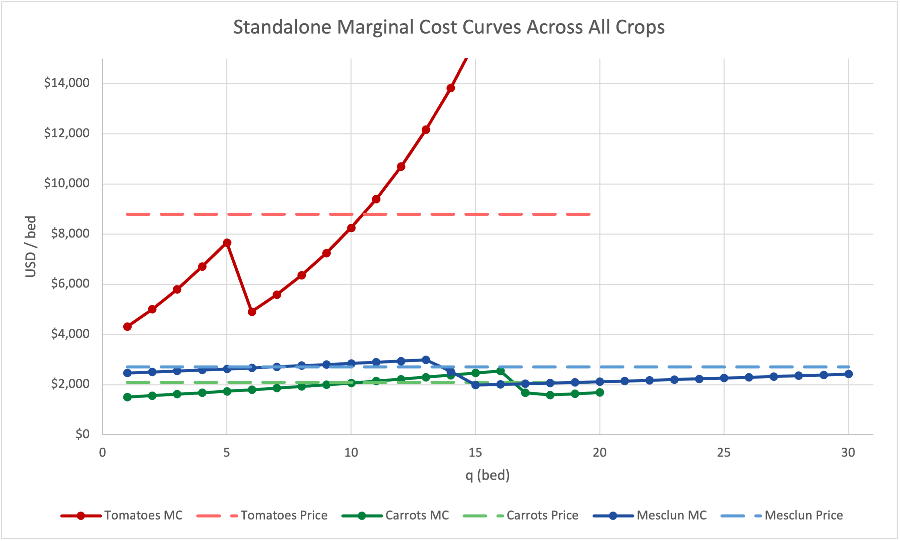

# Perfect Competition — Marginal Analysis & Optimization Report

**Author**: Yeongsu (Harry) Lee  
**Date**: October 20, 2026  
**Capability**: `marginal-analysis`  
**Engagement**: `perfect-competition`  
**Workbook Reference**: `capabilities/marginal-analysis/model.xlsx` (Audited Commit `c27726e`)  

---

## Executive Summary

This study analyzes the profit-maximizing crop allocation for a 1.5-acre market garden operating across a 36-week season with 64 available land beds and 6,480 seasonal labor hours. Utilizing an Excel-based non-linear optimization model (`model.xlsx`) governed by precise marginal analysis ($P = MC$) and compounding labor diminishing returns, the farm achieves a maximum seasonal net profit of **$42,761.66** (`NET_SEASON_PROFIT`, Cell `Farm_Model!B51`). While total land (60/64 beds) and labor capacity (5,277.22/6,480 hours) remain slack at the optimum, individual administrative crop caps for carrots (20 beds) and mesclun (30 beds) bind strictly. The optimal planting mix is **10 tomato beds**, **20 carrot beds**, and **30 mesclun beds** (`BEDS_TOMATOES`, `BEDS_CARROTS`, `BEDS_MESCLUN`, Cells `Farm_Model!B42:B44`).

---

## 1. Where Does the Money Crop Stop, and Why There?

Tomatoes represent the farm's primary "money crop," generating gross revenue of **$8,800.00 per bed** (`REV_PER_BED_TOMATOES`, Cell `Farm_Model!B9`), which is over three times higher than mesclun ($2,700.00) and four times higher than carrots ($2,094.00). Despite this overwhelming top-line revenue advantage and an individual land cap of 20 beds (`BED_CAP_TOMATOES`, Cell `Farm_Model!B6`), the model stops planting tomatoes at **exactly 10 beds** (`BEDS_TOMATOES`, Cell `Farm_Model!B42`), leaving 10 potential tomato beds unplanted.

As illustrated in Figure 1 (`figures/tomato-mc.png`), the decision variable governing this stopping point is not gross revenue per bed, but the relationship between marginal revenue ($P$) and exact marginal cost ($MC$). Crucially, while summary P&L schedules allocate labor using a farm-wide blended rate ($19.73/hr, Cell `Farm_Model!B37`), the true profit-maximizing decision driver is the step-wise marginal cost of actual labor hours added. Tomatoes suffer from a severe 10% compounding diminishing-returns rate (`DIM_RATE_TOMATOES`, Cell `Farm_Model!B18`) applied against a high weekly base labor requirement of 2.5 hours/bed/week (`BASE_HRS_TOMATOES`, Cell `Farm_Model!B12`).

As shown in the bed-by-bed marginal schedule (`Farm_Model!A81:N101`):
* At **Bed 10**, marginal labor required is 424.43 hours (`MARGINAL_LABOR_HRS(10)`, Cell `Farm_Model!D91`). Evaluated at the actual marginal temporary wage rate ($17.36/hr, Cell `Farm_Model!B28`), standalone $MC(10)$ equals **$8,248.59** (Cell `Farm_Model!N91`). Because $8,248.59 remains under the $8,800.00 price line, Bed 10 is profitable and adds +$551.41 to net profit. (Under the farm-wide blended rate allocation, $MC(10)$ appears as $9,253.92 in Cell `Farm_Model!I91`, but this is an accounting allocation artifact of farm-wide labor aggregation that does not alter incremental cash profit).
* At **Bed 11**, marginal labor required jumps to 490.22 hours (`MARGINAL_LABOR_HRS(11)`, Cell `Farm_Model!D92`). This drives the true step-wise $MC(11)$ up to **$9,390.72** (Cell `Farm_Model!N92`) and blended $MC(11)$ to $10,551.88 (Cell `Farm_Model!I92`).

Because the actual marginal cost of producing the 11th bed ($9,390.72) exceeds the constant marginal revenue of $8,800.00 ($MC > P$), planting an 11th tomato bed would reduce overall farm net profit by **$590.72** (from $42,761.66 down to $42,170.95). Therefore, economic marginalism ($P = MC$), rather than an administrative land cap fence, stops tomato production at 10 beds.

---

## 2. Which Constraints Bind, and What Would Relaxing One Be Worth?

An evaluation of all farm constraints in the optimization block (`Farm_Model!A53:D59`) reveals which constraints actively limit profitability and measures the exact value (shadow price) of expanding each constraint by one unit:

| Constraint Name | Model Cell | Constraint Expression | Status at Optimum | Slack / Idle Capacity | Shadow Price / Value of +1 Unit |
| :--- | :--- | :--- | :--- | :--- | :--- |
| **Carrot Bed Cap** | `Farm_Model!B55` | `BEDS_CARROTS <= 20` | **Binding** | 0 beds | **+$352.49 / bed** |
| **Mesclun Bed Cap** | `Farm_Model!B56` | `BEDS_MESCLUN <= 30` | **Binding** | 0 beds | **+$246.47 / bed** |
| **Tomato Bed Cap** | `Farm_Model!B54` | `BEDS_TOMATOES <= 20` | **Slack** | 10 beds | $0.00 |
| **Total Land Capacity**| `Farm_Model!B57` | `TOTAL_BEDS_PLANTED <= 64`| **Slack** | 4 beds | $0.00 |
| **Total Labor Hours** | `Farm_Model!B58` | `TOTAL_FARM_LABOR_HRS <= 6480`| **Slack** | 1,202.78 hours | $0.00 |
| **Temporary Workers** | `Farm_Model!B38` | `TEMP_HRS_NEEDED <= 5760` | **Slack** | 1,202.78 hours | $0.00 |

### Economic Evidence: Fence vs. Economics
Whereas tomato production is stopped by economics ($P = MC$ at 10 beds), carrots and mesclun are stopped strictly by administrative fences (bed caps), as shown in Figure 2 (`figures/standalone-mc.png`). Consistent with the true step-wise wage rate ($17.36/hr) used in §1 and shadow price sensitivity analysis:
* **Carrots**: At Bed 20 (the cap), the standalone marginal cost is **$1,688.95** (`STANDALONE_MC(20)`, Cell `Farm_Model!N124`), well below the $2,094.00 market price ($P > MC$). (Even under the farm-wide blended rate allocation in Cell `Farm_Model!I124`, $MC(20)$ equals $1,859.35, remaining comfortably below price). Economics wants to plant more carrots; only the 20-bed fence stops production.
* **Mesclun**: At Bed 30 (the cap), the standalone marginal cost is **$2,420.10** (`STANDALONE_MC(30)`, Cell `Farm_Model!N157`), below the $2,700.00 market price ($P > MC$). (Under the blended rate allocation in Cell `Farm_Model!I157`, $MC(30)$ equals $2,630.22, also remaining below price). Economics wants to plant more mesclun; only the 30-bed fence stops production.

### True Economic Value of Constraint Relaxation (Sensitivity Analysis)
Shadow prices reflect the actual change in seasonal net profit when a constraint bound is relaxed by one unit, evaluated at the true marginal wage rate ($17.36/hr):
* **Carrot Bed Cap (+1 Bed, 20 $\to$ 21)**: Planting a 21st carrot bed adds 74.97 labor hours (`MARGINAL_LABOR_HRS(21)` = 74.97 hrs). Billed at $17.36/hr ($1,301.51) plus $440.00 fertilizer, total variable cost is $1,741.51. Subtracting this from $2,094.00 revenue yields a net profit gain of **+$352.49 per bed**, increasing net season profit to $43,114.16.
* **Mesclun Bed Cap (+1 Bed, 30 $\to$ 31)**: Planting a 31st mesclun bed adds 90.64 labor hours (`MARGINAL_LABOR_HRS(31)` = 90.64 hrs). Billed at $17.36/hr ($1,573.53) plus $880.00 fertilizer, total variable cost is $2,453.53. Subtracting this from $2,700.00 revenue yields a net profit gain of **+$246.47 per bed**, increasing net season profit to $43,008.14.
* **General Land & Labor Constraints**: Total farm land (60/64 beds used) and total labor (5,277.22/6,480 hours used) both have remaining capacity. Relaxing general land or labor capacity adds **$0.00** to profit.

### Expansion Guidance: Which Ground/Cap to Expand First
Spending money to acquire general farmland or hire additional base labor capacity would be completely wasteful ($0.00 shadow price). However, expanding specific crop administrative caps provides substantial financial returns. If the farmer seeks to acquire or negotiate additional planting capacity, **expanding the Carrot Bed Cap should be prioritized first (valued at +$352.49/bed)**, followed by expanding the **Mesclun Bed Cap (valued at +$246.47/bed)**.

---

## 3. Does Any Marginal Cost Curve Ever Fall, and What Would Explain It?

When mapping bed-by-bed marginal costs across all three crops in isolation, **every single crop's standalone marginal cost curve exhibits a distinct downward "dip"** before resuming its upward trajectory. 

As depicted in Figure 2 (`figures/standalone-mc.png`), this non-monotonic dip is not unique to tomatoes; it appears systematically across all crops whenever cumulative standalone labor crosses the owner's 720-hour capacity threshold (`OWNER_MAX_HRS`, Cell `Farm_Model!B24`).

### Bed-by-Bed Dips Across All Crops
As recorded in the standalone schedules (`Farm_Model!N82:N157`):
1. **Tomatoes (Dip at Bed 6)**:
   * **Bed 5**: Cumulative labor reaches 724.73 hours (Cell `Farm_Model!B86`), crossing 720 hours. Marginal labor (197.65 hrs) is billed partly at owner rate ($34.72/hr) and partly at temporary rate ($17.36/hr), resulting in $MC(5) = \mathbf{\$7,660.86}$ (Cell `Farm_Model!N86`).
   * **Bed 6**: Cumulative labor reaches 956.64 hours (Cell `Farm_Model!B87`). All 231.91 marginal hours are billed 100% at the lower temporary wage rate ($17.36/hr). Consequently, $MC(6)$ **dips sharply to $4,906.28** (Cell `Farm_Model!N87`), a $2,754.58 cost reduction per bed.
2. **Carrots (Dip at Bed 18)**:
   * **Bed 16**: Cumulative labor is 712.56 hours (Cell `Farm_Model!B120`), just under 720 hours, billed 100% at $34.72/hr ($MC(16) = \mathbf{\$2,552.10}$, Cell `Farm_Model!N120`).
   * **Bed 17**: Cumulative labor reaches 776.03 hours (Cell `Farm_Model!B121`), crossing 720 hours ($MC(17) = \mathbf{\$1,670.90}$).
   * **Bed 18**: Billed 100% at $17.36/hr, $MC(18)$ **dips to its bottom at $1,589.14** (Cell `Farm_Model!N122`), a $962.96 cost reduction per bed compared to Bed 16.
3. **Mesclun (Dip at Bed 15)**:
   * **Bed 13**: Cumulative labor is 687.53 hours (Cell `Farm_Model!B140`), under 720 hours, billed 100% at $34.72/hr ($MC(13) = \mathbf{\$2,988.40}$, Cell `Farm_Model!D140`).
   * **Bed 14**: Cumulative labor reaches 749.67 hours (Cell `Farm_Model!B141`), crossing 720 hours ($MC(14) = \mathbf{\$2,522.58}$).
   * **Bed 15**: Billed 100% at $17.36/hr, $MC(15)$ **dips to its bottom at $1,983.96** (Cell `Farm_Model!N142`), a $1,004.44 cost reduction per bed compared to Bed 13.

### Universal Economic Explanation
Physical diminishing returns never reverse for any crop; compounding diminishing penalties continuously increase physical labor hours required per bed. Instead, the **input factor price of labor changes abruptly**.

Because hired temporary labor ($17.36/hr) costs exactly half of owner field labor ($34.72/hr), the dollar cost per marginal hour drops by 50% once owner hours are fully exhausted. Across all crops, this wage reduction temporarily outweighs physical hour growth, creating a sharp cost dip before compounding physical penalties eventually push marginal cost back upward.

This universal pattern demonstrates that Marginal Cost curves measure **economic opportunity cost**—the dollar cost of marginal output combining both physical returns and input factor prices—rather than pure physical engineering productivity.

---

## 4. Would Each Crop Make Money on Its Own, and Does That Matter?

To evaluate standalone viability, we analyze each crop's contribution margin and test whether it covers the farm's $20,000.00 fixed overhead (`FIXED_COSTS`, Cell `Farm_Model!B23`). To provide a direct comparison against the farm optimum, standalone contributions are evaluated using the acreage allocated at the farm optimal mix (10 tomato, 20 carrot, 30 mesclun beds):

| Crop | Acreage Evaluated | Variable Contribution at Farm Optimum (`CROP_CUMULATIVE_CONTRIBUTION`) | True Standalone Contribution (Single Crop Grown Alone) | Standalone Net Profit / (Loss) Less $20k Fixed Overhead |
| :--- | :--- | :--- | :--- | :--- |
| **Tomatoes** | 10 beds | **$33,143.42** (`Farm_Model!H42`) | **$26,172.77** | **+$6,172.77** (Profitable) |
| **Carrots** | 20 beds | **$13,682.27** (`Farm_Model!H43`) | **$3,511.08** | **-$16,488.92** (Unprofitable) |
| **Mesclun** | 30 beds | **$15,935.98** (`Farm_Model!H44`) | **$8,077.81** | **-$11,922.19** (Unprofitable) |

### Relevant Costs in Planting Decisions
If evaluated against Average Total Cost ($ATC$) or full fixed overhead allocation, carrots and mesclun appear unprofitable on a standalone basis and candidates for elimination. However, applying fixed overhead to incremental planting decisions is a fundamental accounting fallacy, as fixed costs ($20,000.00) are sunk overhead owed regardless of planting choices.

The relevant decision criteria for planting an incremental bed are **Marginal Analysis ($P \ge MC$)** and **Average Variable Cost ($P \ge AVC$)**:
* At the farm optimal mix, carrots contribute $13,682.27 and mesclun contributes $15,935.98 toward covering fixed overhead.
* Combined, carrots and mesclun generate **$29,618.25** in contribution margin above variable labor and fertilizer expenses.

Eliminating carrots and mesclun because they fail a standalone $ATC$ test would leave tomatoes as the sole crop. Grown in isolation, 10 tomato beds generate a standalone contribution of $26,172.77. Subtracting $20,000.00 fixed overhead would collapse farm net profit from **$42,761.66** down to **$6,172.77**—a profit reduction of **$36,588.89**. Price exceeding Marginal Cost ($P > MC$) and Average Variable Cost ($P > AVC$) settles the planting decision, completely independent of fixed overhead.

---

## 5. Hypothesis Comparison & Self-Audit

In the Stage 1 Brief, I hypothesized an optimal allocation of **30 mesclun beds, 20 carrot beds, and 14 tomato beds**, predicting that compounding labor penalties would stop tomato expansion past 14 beds.

The model falsified my specific tomato prediction: the true optimal allocation is **10 tomato beds** (4 beds lower than hypothesized), achieving a maximum net seasonal profit of **$42,761.66**.

### Precision Audit: Why the Prior Was Off
My Stage 1 Brief error was not a failure to calculate labor escalation—I had correctly computed standalone $MC(14)$ at $13,825.00. Rather, my analytical flaw was **failing to check intermediate beds prior to Bed 14**.

Because $MC(14) = \$13,825.00$ exceeded the $8,800.00 price line by over 50%, the mathematical signal was already present that the $P = MC$ crossing point lay at a significantly lower bed count. Rigorous step-by-step evaluation of `q × (1 + DIM_PCT)^q` reveals that by Bed 11, marginal labor required reaches 490.22 hours (`MARGINAL_LABOR_HRS(11)`, Cell `Farm_Model!D92`), pushing standalone $MC(11)$ to **$9,390.72**—already $590.72 above price.

Checking every bed sequentially from Bed 1 onward corrected my spot-check oversight, verifying that tomato production strictly stops at 10 beds.
